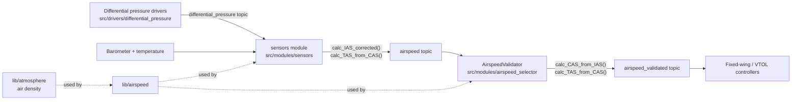

# airspeed

Pure math library that turns pitot-tube pressure readings into airspeed. No state,
no threads, no uORB. Every function takes numbers in and returns a number.

## Where it sits



## Terms

| Term | Meaning |
| --- | --- |
| IAS | Indicated airspeed: straight from the pressure difference, assuming sea-level air |
| CAS | Calibrated airspeed: IAS corrected for sensor/installation error (`scale`) |
| TAS | True airspeed: CAS corrected for actual air density (altitude, temperature) |

## Functions

| Function | Does |
| --- | --- |
| `calc_IAS(dp)` | Bernoulli: `sqrt(2 * dp / 1.225)`, signed |
| `calc_IAS_corrected(...)` | IAS plus compensation for the sensor model (membrane or SDP3x) and tube losses |
| `calc_CAS_from_IAS(ias, scale)` | `ias * scale` |
| `calc_TAS_from_CAS(cas, p, T)` | Density correction from static pressure and temperature. NaN temperature falls back to 15 C |
| `calc_TAS(p_total, p_static, T)` | TAS directly from total and static pressure |
| `calc_true_from_calibrated_airspeed` / `calc_calibrated_from_true_airspeed` | Convert between CAS and TAS for a given density |

Units: pressure in Pa, temperature in degrees C, speed in m/s, density in kg/m^3.
A negative pressure difference gives a negative speed (sign is preserved).

## Tests

`AirspeedTest.cpp` (gtest). Run with:

```
make tests TESTFILTER=Airspeed
```
